# 🎮 ChzzkCardTradeView (치지직 스트리머 카드 수집 및 거래 플랫폼)

치지직 스트리머들의 정보를 카드화하여 수집, 거래, 강화하는 실시간 웹 애플리케이션 서비스 기획 및 개발 명세서입니다. 본 프로젝트는 치지직 OpenAPI를 활용하여 스트리머의 실제 방송 활동량(팔로워, 방송 시간, 채팅량 등)이 카드의 가치와 시세에 동적으로 반영되는 독창적인 시스템을 제공합니다.

---

## 📌 목차
1. [프로젝트 소개](#-프로젝트-소개)
2. [핵심 기능 명세](#-핵심-기능-명세)
3. [기술 스택 (Tech Stack)](#-기술-스택-tech-stack)
4. [시스템 아키텍처 및 폴더 구조](#-시스템-아키텍처-및-폴더-구조)
5. [데이터베이스 스키마 설계 (Database Schema)](#-데이터베이스-스키마-설계-database-schema)
6. [API 명세서 (API Specification)](#-api-명세서-api-specification)
7. [로컬 개발 환경 구축 가이드](#-로컬-개발-환경-구축-가이드)
8. [배포 가이드 (Deployment Guide)](#-배포-가이드-deployment-guide)

---

## 1. 📝 프로젝트 소개
**ChzzkCardTradeView**는 스트리머와 팬덤을 잇는 새로운 형태의 게이미피케이션(Gamification) 플랫폼입니다.
치지직에서 활동하는 150명 이상의 팔로워를 보유한 스트리머들의 활성 데이터를 기반으로 고유한 등급의 디지털 카드를 생성하며, 유저들은 획득한 카드를 인벤토리에 수집하거나 실시간 마켓 및 P2P 거래를 통해 다른 유저와 교환할 수 있습니다.

### 핵심 가치 및 차별점
* **실시간 가치 연동:** 고정된 가치의 카드가 아닌, 스트리머의 실제 활동량 지표가 실시간/주기적으로 카드 시세 및 등급에 영향을 줍니다.
* **치지직 생태계 친화적:** 치지직 OpenAPI 계정 연동을 통해 별도의 복잡한 절차 없이 간편하고 안전한 인증을 지원합니다.
* **유저 주도 경제:** 유저 간 1:1 카드 교환 및 재화 거래를 통해 건강하고 자유로운 가상 경제 생태계를 구축합니다.

---

## 2. ⚡ 핵심 기능 명세

### 2.1 스트리머 카드화 및 포토카드 시스템
* **대상 기준:** 치지직 API 기준 팔로워 **150명 이상**의 활성화된 스트리머.
* **카드 가치 결정 알고리즘:**
  * 기본 가치 및 등급은 스트리머의 `팔로워 수`, `주간 방송 시간`, `평균 채팅량(시청자 참여도)` 등의 지표를 합산한 종합 점수(Activity Score)로 산정됩니다.
  * 주기적 배치 작업을 통해 지표가 갱신되며, 카드의 기본 가치(시세)가 등락합니다.
* **실시간 정보 갱신 포토카드 디자인:**
  * 스트리머 카드는 기본적으로 스트리머의 치지직 프로필 이미지를 메인 배경으로 적용한 현대적인 포토카드 레이아웃을 취합니다.
  * 카드 전면에는 **스트리머 이름, 실시간 팔로워 수, 현재 카드 가치**가 시각적으로 표시되며, 이 정보들은 Supabase Realtime 또는 Polling 기법을 통해 유저의 화면에서 **실시간으로 동적 갱신**됩니다.
* **스트리머 전용 커스텀 이미지 관리 (지연 업로드 및 리사이즈 최적화):**
  * 치지직 인증을 통해 연동된 스트리머 본인은 자신의 카드 배경 이미지를 직접 변경하여 개성을 부여할 수 있습니다.
  * **지연 업로드 방식(Lazy Preview):** 파일을 올렸을 때 즉시 서버에 업로드하지 않고 브라우저 로컬 단에서 `blob` 미리보기 주소(Object URL)를 생성해 임시 렌더링하고, 사용자가 화면의 **'저장' 버튼을 최종 클릭해야만 실제 스토리지 업로드가 수행**됩니다.
  * **1280px 리사이즈 및 WebP 파일 최적화:** 서버 스토리지 및 네트워크 대역폭 리소스를 절약하기 위해, 업로드 과정에서 이미지의 **가로/세로 길이를 최대 1280px 비율에 맞게 리사이즈**하고 압축 효율이 극대화된 **WebP 포맷**으로 일괄 변환하여 저장합니다.
* **관리자 규제 및 초기화 제어 (Admin Policy):**
  * 관리자는 부적절한 이미지를 사용하는 스트리머의 카드 이미지를 즉시 치지직 **기본 프로필 사진으로 강제 초기화(Reset)**할 수 있습니다.
  * 관리자는 악의적이거나 비정상적인 이미지 업로드를 차단하기 위해 특정 스트리머의 **커스텀 이미지 수정 권한을 차단(Ban)**할 수 있습니다. 권한이 차단된 스트리머는 더 이상 커스텀 업로드가 불가능하며 기본 프로필만 사용 가능합니다.

### 2.2 카드 뽑기 (Gacha) 및 재화 시스템
* **기본 뽑기:** 하루 1회 무료 뽑기(Daily Free Pull) 제공.
* **추가 뽑기:** 인게임 재화(포인트)를 소모하여 뽑기 진행.
* **확률형 아이템 설계:**
  * 카드의 가치가 높을수록 획득 확률이 기하급수적으로 감소합니다.

### 2.3 실시간 1:1 교환 (Trade) 시스템
* **교환 방식:**
  * 카드 ↔ 카드 (물물교환)
  * 카드 ↔ 재화 (포인트 거래)
  * 카드 + 재화 ↔ 카드 + 재화 (복합 거래)
* **안전장치:** 양측 유저가 교환 조건을 확정한 뒤, 최종 '교환 승인'을 단계별로 수락해야 완료되는 2단계 트랜잭션 보장(Double-Lock) 메커니즘을 적용합니다.

### 2.4 인벤토리 및 마이페이지
* **카드 관리:** 보유 중인 카드를 스트리머 이름순, 가치순으로 필터링 및 정렬하여 한눈에 볼 수 있습니다.
* **프로필 관리:** 내 보유 재화, 대표 카드 설정, 교환 이력 통계 시각화.

### 2.5 실시간 랭킹 & 시세 보드
* **시세 분석:** 최근 24시간 동안 가장 가치가 많이 상승한 카드, 하락한 카드의 실시간 등락폭을 차트로 시각화.
* **유저 랭킹:** 보유한 총 카드 가치 및 보유 재화를 합산하여 산정되는 실시간 유저 순위 제공.

### 2.6 관리자 제어 센터 (Admin Panel)
* **대시보드:** 유저 현황, 총 거래 횟수, 카드 배포 현황 및 시스템 트래픽 요약 지표 제공.
* **신고 모니터링 & 유저 밴 관리:** 유저로부터 유입된 실시간 카드 신고 내역을 확인하고, 문제 유저를 기간별로 제재할 수 있는 UI 제공.

### 2.7 일회성/다회성 쿠폰 시스템 (Coupon System)
* **쿠폰 발급:** 관리자는 지정된 포인트 혜택을 주는 쿠폰을 신규 발급할 수 있습니다.
* **유연한 설정 옵션:**
  * **속성:** 일회성(1인 1회 제한 및 선착순 사용 완료 시 소멸) 및 다회성(여러 유저가 정해진 유효기간 내 1회씩 반복 사용 가능) 구분.
  * **유효기간:** 만료 일시(Expiry Date) 지정 가능.
  * **쿠폰 키:** UUID 기반 자동 랜덤 생성 혹은 이벤트성 특정 텍스트(예: `WELCOME2026`) 직접 수동 입력 지원.
* **사용 이력 추적:** 동일 쿠폰 중복 수령 방지를 위해 쿠폰 사용 로그를 기록합니다.

### 2.8 팝업 공지 및 게시판 (Announcement & Popups)
* **홈페이지 팝업:** 긴급 또는 주요 공지사항은 접속 시 홈페이지 전면에 오버레이 팝업으로 우선 노출(유효기간 적용 및 '오늘 하루 보지 않기' 로컬 캐싱 기능 지원).
* **공지사항 게시판:** 전체 공지글을 시간순으로 열람할 수 있는 독립 게시판 공간을 제공합니다.

### 2.9 PWA 및 예약형 푸시 알림 (PWA & Web Push Notification)
* **PWA 지원:** 모바일/PC 브라우저에서 '홈 화면에 추가(설치)' 및 독립된 앱 구동 환경(Service Worker 캐싱)을 지원합니다.
* **웹 푸시 알림:** 사용자의 Web Push 알림 수신 동의를 받아 백그라운드 푸시 알림 수신 토큰을 수집합니다.
* **수동/예약 푸시 발송:**
  * 관리자는 즉시 전체 알림을 전송할 수 있습니다.
  * 특정 날짜 및 시각을 타겟하여 알림을 보낼 수 있는 **예약 발송(cron 스케줄러)** 기능을 지원합니다.

### 2.10 카드 신고 및 악성 유저 제재 (Report & User Ban System)
* **카드 신고 기능:**
  * 유저는 스트리머의 커스텀 카드 이미지가 부적절한 경우(선정성, 혐오 등) 신고할 수 있습니다.
  * **신고 당시의 이미지 스냅샷 보존:** 스트리머가 사후에 이미지를 변경해 증거를 인멸하는 것을 방지하기 위해, **신고 버튼을 누른 바로 그 시점의 커스텀 이미지 URL**을 신고 데이터와 함께 DB에 영구 기록하여 보존합니다.
* **유저 밴 시스템:**
  * 고의적으로 타인을 음해하기 위해 허위 신고를 남발하거나, 시스템 규정을 반복적으로 어기는 악성 유저에 대한 차단 조치를 제공합니다.
  * 관리자는 대상 유저에 대해 **1일 차단, 7일 차단, 30일 차단, 영구 차단(Permanent Ban)** 옵션을 선택해 제재할 수 있습니다.
  * 차단된 유저는 차단 만료 시점까지 서비스 로그인 및 활동(뽑기, 교환, 신고 등)이 제한됩니다.

### 2.11 반응형 UI & 디자인 시스템 표준 (Adaptive & Responsive UI)
* **모바일 및 PC 적응형 대응 (Hybrid Layout):**
  * Tailwind CSS Breakpoints(`sm`, `md`, `lg`, `xl`, `2xl`)를 적극적으로 사용하여 모바일 세로 뷰부터 초광대역 PC 뷰까지 자연스럽게 변경되는 Fluid 그리드 및 네비게이션 적용.
  * **모바일 하단 내비게이션 바(Bottom Navigation Bar):** 화면 하단에 상시 노출되는 4대 핵심 탭 기반으로 사용자 동선을 구성하고 스와이프 제스처를 매칭합니다.
  * **PC 사이드바 내비게이션:** 대화면 PC 환경에서는 하단 바 대신 좌측 고정 사이드바(Sidebar) 형태로 탭을 확장 노출하고, 와이드 화면비에 맞추어 카드 격자 그리드를 4K 해상도까지 유동적 비율로 스케일링합니다.
* **4대 핵심 탭 구조 명세:**
  1. **메인 탭 (Main):**
     * 간략화된 스트리머 실시간 방송 상태 및 급상승/급하락 카드 정보 요약.
     * 진행 중인 팝업 공지 및 최신 공지사항 헤드라인 링크 노출.
     * 플랫폼 소개 및 로그인한 유저의 보유 자산(포인트 등) 요약 카드 배치.
  2. **뽑기 및 인벤토리 탭 (Draw & Inventory):**
     * **카드 뽑기(Gacha):** 무료/포인트 추가 뽑기 인터페이스.
     * **인벤토리:** 수집한 카드를 격자형(Grid) 포토카드 뷰로 관리.
     * **교환 기능 통합:** 인벤토리 내에서 특정 카드를 선택하여 타 유저에게 실시간 1:1 교환(Trade)을 제안하는 팝업 및 교환 신청 수신함 통합 제공.
  3. **랭킹 탭 (Ranking):**
     * 가치 기준 스트리머 카드 실시간 순위 및 주간 등락폭 표시.
     * 보유 자산 기준 실시간 유저 랭킹 제공.
  4. **내 정보 탭 (My Info):**
     * 내 상세 정보 열람 및 치지직 계정 연동 해제.
     * 유저가 사용할 발급된 쿠폰 입력란.
     * **스트리머 전용 제어기:** 스트리머 본인 확인 시 활성화되는 커스텀 포토카드 이미지 업로드 및 관리 콘솔.
     * **관리자 전용 제어기 (Admin Panel):** 'ADMIN' 권한을 지닌 사용자만 진입 가능한 쿠폰 발급, 긴급 팝업 등록, 푸시 알림 예약, 악성 유저 차단(Ban) 등의 어드민 전용 링크 배치.
* **화면 해상도 독립적 크기 조정 (HD to 4K Scalability):**
  * 고정 픽셀(`px`) 레이아웃을 지양하고, 루트 폰트 크기(`rem`) 기반의 상대적인 크기 지정 방식과 Tailwind의 Container Queries를 적용하여 HD(1080p), QHD, 4K(2160p) 대화면에서도 레이아웃이 뭉개지거나 작아지지 않는 유동적인 비율 스케일링 제공.
  * 이미지 및 카드 컴포넌트의 화면 비율(`aspect-ratio`)을 엄격히 지정하여 초고해상도 디스플레이에서도 일관된 사용자 경험(UX) 보장.
* **엄격한 다크 모드 및 라이트 모드 (Strict Mode Theming):**
  * shadcn/ui의 CSS Variables 테마 엔진을 내장하여 라이트 및 다크 테마의 색상을 1:1로 엄격하게 대칭 정의.
  * **라이트 모드:** 눈의 피로를 최소화하기 위해 순수 백색이 아닌 부드러운 오프화이트(Off-white, HSL 0 0% 98%)와 Slate 톤의 고대비 텍스트 매칭.
  * **다크 모드:** 진한 회색이나 제트 블랙 계열(HSL 240 10% 3.9%)을 바탕으로, 카드 가치 표시 및 브랜드 포인트 컬러의 명도를 조정하여 시독성 보장. (강제 색 반전이 아닌 디자인 의도에 맞춘 완벽 분리 테마)

---

## 3. 🛠 기술 스택 (Tech Stack)

| 구분 | 기술 기술 | 역할 및 상세 사양 |
| :--- | :--- | :--- |
| **Frontend** | `Next.js 14+ (App Router)` | SSR/ISR 기반 최적화 렌더링, SEO 친화적 라우팅 |
| | `TypeScript` | 타입 안정성 확보 및 컴파일 타임 에러 방지 |
| | `Tailwind CSS` & `shadcn/ui` | 유틸리티 퍼스트 디자인 기반 및 Radix UI 기반의 컴포넌트 설계 |
| | `Zustand` / `React Query` | 전역 클라이언트 상태 및 서버 데이터 캐싱 관리 |
| | `PWA (next-pwa)` | 서비스 워커 셋업, 앱 설치 매니페스트 및 백그라운드 푸시 알림 수신 지원 |
| **Backend** | `Node.js` & `Express` | RESTful API 서버, 비즈니스 로직 처리 (TypeScript 적용) |
| | `Node-cron` | 스트리머 정보 갱신 배치 및 푸시 알림 예약 스케줄 처리 |
| | `Web-push` | VAPID 암호화 프로토콜을 활용한 모바일/PC 브라우저 푸시 알림 발송 라이브러리 |
| **Database** | `Supabase` (PostgreSQL) 및 `SQLite` | 기본적으로 Supabase 클라우드를 사용하며, 오프라인 시 로컬 SQLite SQL 파일로 자동 폴백 |
| **OpenAPI** | `Chzzk API` | 치지직 스트리머 채널 정보 추출 및 로그인 연동 |
| **Deployment** | `Vercel` (Frontend) | 프론트엔드 호스팅 및 자동 CI/CD 파이프라인 구축 |
| | `Render` / `Docker` (Backend) | 백엔드 애플리케이션 및 스케줄러 호스팅 |
| **Package** | `npm` | 패키지 의존성 관리 |

---

### 3.1 하이브리드 데이터베이스 폴백 시스템 (DB Fallback System)
* **Supabase 오프라인 감지:** 백엔드 구동 또는 API 요청 초기 단계에서 Supabase DB에 대한 PING 및 인증 연결 상태를 감지합니다.
* **로컬 SQL (SQLite) 폴백 우회:** 
  * Supabase URL/Key가 누락되었거나 통신 불가 상태일 시, 백엔드는 즉시 내장된 로컬 SQLite 파일 데이터베이스(`local.db`)로 동작 모드를 전환합니다.
  * 레포지토리 패턴(Repository Pattern)을 기반으로 데이터 액세스 레이어를 추상화하여, 상위 비즈니스 로직(Service 레이어)의 코드 수정 없이 투명한 데이터 읽기/쓰기 분기를 보장합니다.

---

## 4. 🗂 시스템 아키텍처 및 폴더 구조

### 4.1 시스템 아키텍처
```
[Client (Next.js PWA)] ◄─── (REST API / Web Push) ───► [Backend (Node.js)]
        │                                                     │
        ├─ (Realtime / Auth Direct) ─► [Supabase BaaS]        ├─ (Local DB Fallback)
        │                                                     ▼
        ▼ (OpenAPI Requests)                          [Local SQL (SQLite)]
[Chzzk OpenAPI (치지직)]
```

### 4.2 프로젝트 디렉토리 구조
프로젝트는 관심사의 분리(Separation of Concerns)를 극대화하기 위해 프론트엔드와 백엔드가 분리된 모노레포 또는 멀티레포 구조로 설계됩니다.

```
ChzzkCardTradeView/
├── frontend/               # Next.js 프론트엔드 애플리케이션
│   ├── public/             # PWA 매니페스트(manifest.json), 아이콘, 서비스 워커
│   ├── src/
│   │   ├── app/            # App Router 페이지 컴포넌트 (admin 전용 라우트 포함)
│   │   ├── components/     # 공통 UI 및 기능 컴포넌트 (Popup, Card 등)
│   │   ├── hooks/          # 커스텀 훅 (PWA 설치 등록, 알림 권한 획득 등)
│   │   ├── services/       # API 호출 서비스 레이어
│   │   ├── types/          # TypeScript 타입 정의 파일
│   │   └── utils/          # 헬퍼 함수 공통 모듈
│   ├── tailwind.config.js
│   └── package.json
│
├── backend/                # Node.js 백엔드 서버 애플리케이션
│   ├── src/
│   │   ├── controllers/    # 요청 처리 및 응답 핸들러 (Admin 전용 포함)
│   │   ├── services/       # 핵심 비즈니스 로직 (Web Push, Coupon 검증 등)
│   │   ├── repositories/   # DB 쿼리 및 Supabase 데이터 엑세스
│   │   ├── cron/           # 스케줄러 (가치 변동 및 예약 푸시 전송)
│   │   ├── middlewares/    # 인증 및 어드민 전역 에러 핸들러
│   │   └── app.ts          # 서버 엔트리 포인트
│   ├── tsconfig.json
│   └── package.json
│
└── README.md
```

---

## 5. 🗄 데이터베이스 스키마 설계 (Database Schema)

Supabase(PostgreSQL) 기반으로 설계된 핵심 테이블 구조입니다.

```mermaid
erDiagram
    USERS ||--o{ USER_CARDS : owns
    STREAMERS ||--o{ USER_CARDS : instances
    USERS ||--o{ TRADES : requests
    USERS ||--o{ TRADES : receives
    STREAMERS ||--o{ VALUE_HISTORY : records
    USERS ||--o{ COUPON_LOGS : redeems
    COUPONS ||--o{ COUPON_LOGS : records
    USERS ||--o{ PUSH_SUBSCRIPTIONS : registers

    USERS {
        uuid id PK "치지직 로그인 UID / Supabase Auth ID"
        string username "치지직 닉네임"
        string avatar_url "프로필 이미지 URL"
        string role "권한 구분 ('USER' or 'ADMIN')"
        bigint point "보유 재화 (기본: 0)"
        timestamp last_free_draw "마지막 무료 뽑기 일시"
        timestamp banned_until "유저 차단 만료 일시 (기본: null)"
        timestamp created_at
    }

    STREAMERS {
        string channel_id PK "치지직 채널 고유 ID"
        string name "스트리머 활동명"
        string logo_url "치지직 기본 프로필 로고 URL"
        string custom_image_url "스트리머 업로드 커스텀 이미지 URL (nullable)"
        boolean is_image_banned "커스텀 이미지 업로드 권한 차단 여부 (기본: false)"
        integer follower_count "실시간 팔로워 수"
        integer activity_score "활동 지표 환산 점수"
        integer base_value "현재 환산 시세 (재화 기준)"
        boolean is_active "현재 방송 중 여부"
        timestamp updated_at
    }

    USER_CARDS {
        bigint id PK "자동 증가 고유 ID"
        uuid user_id FK "보유자 고유 ID (USERS)"
        string channel_id FK "스트리머 카드 ID (STREAMERS)"
        integer serial_number "발행 일련번호"
        timestamp acquired_at "획득 일시"
    }

    TRADES {
        bigint id PK "거래 고유 ID"
        uuid sender_id FK "제안자 ID"
        uuid receiver_id FK "수신자 ID"
        jsonb sender_offer "제안품 { cards: [], point: 0 }"
        jsonb receiver_offer "요청품 { cards: [], point: 0 }"
        string status "거래 상태 (PENDING, ACCEPTED, REJECTED, CANCELLED)"
        timestamp created_at
        timestamp completed_at
    }

    VALUE_HISTORY {
        bigint id PK
        string channel_id FK "스트리머 ID"
        integer value "변경 시점의 가치"
        timestamp recorded_at "시세 변동 시점"
    }

    COUPONS {
        bigint id PK
        string code "쿠폰 코드 (수동 입력 또는 랜덤 생성)"
        string coupon_type "쿠폰 유형 ('single' or 'multi')"
        integer points "지급 재화 크기"
        integer max_uses "최대 사용 가능 횟수 (multi인 경우)"
        integer used_count "현재 사용 횟수"
        timestamp expires_at "유효 만료 기한"
        timestamp created_at
    }

    COUPON_LOGS {
        bigint id PK
        bigint coupon_id FK "쿠폰 ID"
        uuid user_id FK "사용한 유저 ID"
        timestamp redeemed_at "사용한 시점"
    }

    ANNOUNCEMENTS {
        bigint id PK
        string title "공지 사항 제목"
        text content "공지 내용"
        boolean is_popup "메인 팝업 여부"
        timestamp popup_expires_at "팝업 노출 기한"
        timestamp created_at
    }

    PUSH_SUBSCRIPTIONS {
        bigint id PK
        uuid user_id FK "유저 ID"
        string endpoint "브라우저 푸시 수신 엔드포인트 URL"
        string auth_key "암호화 인증 키(auth)"
        string p256dh_key "암호화 공개 키(p256dh)"
        timestamp created_at
    }

    PUSH_NOTIFICATIONS {
        bigint id PK
        string title "알림 제목"
        string body "알림 본문"
        string status "전송 상태 ('pending', 'sent')"
        timestamp scheduled_at "예약 발송 시각 (즉시 발송 시 null)"
        timestamp created_at
    }

    CARD_REPORTS {
        bigint id PK
        uuid reporter_id FK "신고 유저 ID"
        string channel_id FK "신고 대상 카드 ID"
        string reported_image_url "신고 시점의 카드 이미지 스냅샷 URL"
        text reason "신고 사유"
        string status "처리 상태 ('pending', 'resolved', 'rejected')"
        timestamp created_at
    }
```



---

## 6. 🌐 API 명세서 (API Specification)

### 6.1 사용자 및 인증 (Auth)
* `POST /api/auth/login` : 치지직 로그인 Callback 및 세션 등록
* `GET /api/users/me` : 내 상세 프로필, 보유 재화, 마지막 뽑기 시간 조회

### 6.2 스트리머 및 카드 관련
* `GET /api/streamers` : 스트리머 목록 및 가치 랭킹 조회 (정렬, 필터 포함)
* `GET /api/streamers/:channel_id` : 특정 스트리머 정보 및 시세 변화 그래프 데이터 조회 (이름, 팔로워 수, 현재 가치 실시간 동적 제공)
* `POST /api/cards/draw` : 카드 뽑기 실행 (재화 또는 무료 기회 차감 및 결과 반환)
* `GET /api/cards/my` : 로그인한 사용자의 보유 카드 목록(인벤토리) 조회
* `POST /api/streamers/me/image` : 스트리머 본인의 커스텀 포토카드 이미지 업로드 및 수정 (치지직 인증 정보 검증 필요, 차단 여부 검사)

### 6.3 거래 시스템 (Trade)
* `POST /api/trades` : 새로운 거래 제안 생성
* `GET /api/trades/active` : 내가 연관된 진행 중인 거래 제안 리스트 조회
* `POST /api/trades/:trade_id/accept` : 거래 최종 수락 (DB 트랜잭션 수행)
* `POST /api/trades/:trade_id/reject` : 거래 거절 또는 취소

### 6.4 공지사항 및 쿠폰 등록 (유저 공용)
* `GET /api/announcements` : 전체 공지사항 게시글 목록 조회
* `GET /api/announcements/popups` : 현재 유효한 팝업 공지 리스트 조회
* `POST /api/coupons/claim` : 쿠폰 코드를 입력하여 포인트 지급 요청
* `POST /api/cards/:channel_id/report` : 특정 카드 신고 등록 (신고 시점의 커스텀 카드 이미지 URL 스냅샷 생성 및 기록)

### 6.5 관리자 전역 통제 (Admin 전용 - Admin Middleware 검증)
* `POST /api/admin/coupons` : 일회성/다회성 쿠폰 발급 (유효기간, 코드 형식 지정 가능)
* `GET /api/admin/coupons` : 생성된 쿠폰 목록 및 사용 현황 열람
* `POST /api/admin/announcements` : 공지글 게시 및 팝업 설정 추가
* `DELETE /api/admin/announcements/:id` : 공지글 삭제
* `POST /api/admin/push/send` : 실시간 푸시 알림 즉시 발송
* `POST /api/admin/push/schedule` : 푸시 알림 예약 등록 (스케줄 기반)
* `POST /api/push/subscribe` : (유저 공용) PWA 푸시 알림 토큰 수신 등록
* `POST /api/admin/streamers/:channel_id/image/reset` : 특정 스트리머의 커스텀 카드를 기본 프로필 이미지로 강제 초기화
* `POST /api/admin/streamers/:channel_id/image/ban` : 특정 스트리머의 커스텀 이미지 수정 권한을 영구/일시 차단
* `POST /api/admin/streamers/:channel_id/image/unban` : 특정 스트리머의 이미지 수정 차단 조치 해제
* `GET /api/admin/reports` : 유저들의 카드 신고 목록 조회 (신고 당시 이미지 스냅샷 및 신고 사유 포함)
* `POST /api/admin/reports/:report_id/resolve` : 신고 처리 완료 상태 변경
* `POST /api/admin/users/:user_id/ban` : 특정 유저에 대한 활동 제재 실행 (기간 선택: 1일, 7일, 30일, 영구 차단)
* `POST /api/admin/users/:user_id/unban` : 특정 유저의 활동 제재 해제

---

## 7. 🚀 로컬 개발 환경 구축 가이드

### 7.1 요구사항 (Prerequisites)
* Node.js v18.0.0 이상
* Supabase 계정 및 프로젝트 생성
* 치지직 API 접근용 Developer Token (치지직 연동 필수)

### 7.2 리포지토리 클론 및 설치
```bash
git clone https://github.com/your-username/ChzzkCardTradeView.git
cd ChzzkCardTradeView
```

### 7.3 환경 변수 설정
`frontend/` 및 `backend/` 폴더 내에 각각 `.env` 파일을 생성하고 설정을 진행합니다.

#### Frontend Environment (`frontend/.env.local`)
```env
NEXT_PUBLIC_API_URL=http://localhost:5000
NEXT_PUBLIC_SUPABASE_URL=your_supabase_project_url
NEXT_PUBLIC_SUPABASE_ANON_KEY=your_supabase_anon_key
```

#### Backend Environment (`backend/.env`)
```env
PORT=5000
DATABASE_URL=your_supabase_postgresql_connection_string
SUPABASE_SERVICE_ROLE_KEY=your_supabase_service_role_key
CHZZK_CLIENT_ID=your_chzzk_client_id
CHZZK_CLIENT_SECRET=your_chzzk_client_secret
CHZZK_API_URL=https://api.chzzk.naver.com
```

### 7.4 백엔드 실행
```bash
cd backend
npm install
npm run dev
```

### 7.5 프론트엔드 실행
```bash
cd ../frontend
npm install
npm run dev
```
이후 브라우저에서 `http://localhost:3000`으로 접속할 수 있습니다.

---

## 8. 🌐 배포 가이드 (Deployment Guide)

### 8.1 Frontend (Vercel 배포)
프론트엔드 Next.js 애플리케이션은 **Vercel**을 통해 배포 및 지속적 통합(CI/CD)을 관리합니다.

1. **Vercel 프로젝트 생성:**
   * Vercel Dashboard에 접속하여 GitHub 저장소를 연동합니다.
   * Root Directory를 `frontend`로 설정합니다.
2. **빌드 설정:**
   * Framework Preset: `Next.js`
   * Build Command: `npm run build`
   * Output Directory: `.next`
3. **환경 변수 구성:**
   * Vercel Project Settings -> Environment Variables 메뉴에서 다음 변수들을 등록합니다.
     * `NEXT_PUBLIC_API_URL` (백엔드 배포 주소)
     * `NEXT_PUBLIC_SUPABASE_URL`
     * `NEXT_PUBLIC_SUPABASE_ANON_KEY`
4. **배포 실행:**
   * `main` 브랜치에 코드가 push될 때마다 자동으로 배포가 이루어집니다.

### 8.2 Backend 배포
백엔드 Node.js/Express 서버 및 스케줄러는 Render, Fly.io, 혹은 Docker 컨테이너 기반 클라우드 서비스를 통해 배포합니다.
* 데이터베이스 환경 변수(`DATABASE_URL`, `SUPABASE_SERVICE_ROLE_KEY`) 및 치지직 OpenAPI 키를 백엔드 환경 변수에 추가해야 합니다.

