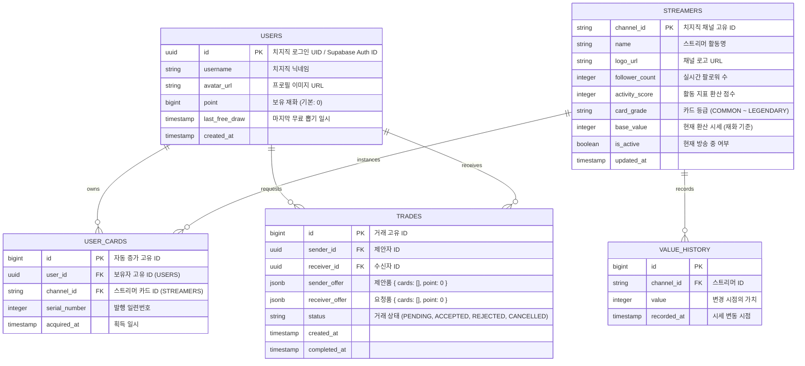

# 🎮 ChzzkCardTradeView (치지직 스트리머 카드 수집 및 거래 플랫폼)

치지직 스트리머들의 정보를 카드화하여 수집, 거래, 강화하는 실시간 웹 애플리케이션 서비스 기획 및 개발 명세서입니다. 본 프로젝트는 치지직 OpenAPI를 활용하여 스트리머의 실제 방송 활동량(팔로워, 방송 시간, 채팅량 등)이 카드의 가치와 시세에 동적으로 반영되는 독창적인 시스템을 제공합니다.

---

## 📌 목차
1. [프로젝트 소개](#-프로젝트-소개)
2. [핵심 기능 명세](#-핵심-기능-명세)
3. [기술 스택 (Tech Stack)](#-기술-스택-tech-stack)
4. [시스템 아키텍처 및 폴더 구조](#-시스템-아키텍처-및-폴더-구조)
5. [데이터베이스 스키마 설계 (Database Schema)](#-데이터베이스-스키마-설계-database-schema)
6. [API 명세서 (API Specification)](#-api-명세서-api-specification)
7. [로컬 개발 환경 구축 가이드](#-로컬-개발-환경-구축-가이드)
8. [배포 가이드 (Deployment Guide)](#-배포-가이드-deployment-guide)

---

## 1. 📝 프로젝트 소개
**ChzzkCardTradeView**는 스트리머와 팬덤을 잇는 새로운 형태의 게이미피케이션(Gamification) 플랫폼입니다.
치지직에서 활동하는 150명 이상의 팔로워를 보유한 스트리머들의 활성 데이터를 기반으로 고유한 등급의 디지털 카드를 생성하며, 유저들은 획득한 카드를 인벤토리에 수집하거나 실시간 마켓 및 P2P 거래를 통해 다른 유저와 교환할 수 있습니다.

### 핵심 가치 및 차별점
* **실시간 가치 연동:** 고정된 가치의 카드가 아닌, 스트리머의 실제 활동량 지표가 실시간/주기적으로 카드 시세 및 등급에 영향을 줍니다.
* **치지직 생태계 친화적:** 치지직 OpenAPI 계정 연동을 통해 별도의 복잡한 절차 없이 간편하고 안전한 인증을 지원합니다.
* **유저 주도 경제:** 유저 간 1:1 카드 교환 및 재화 거래를 통해 건강하고 자유로운 가상 경제 생태계를 구축합니다.

---

## 2. ⚡ 핵심 기능 명세

### 2.1 스트리머 카드화 시스템
* **대상 기준:** 치지직 API 기준 팔로워 **150명 이상**의 활성화된 스트리머.
* **카드 가치 결정 알고리즘:**
  * 기본 가치 및 등급은 스트리머의 `팔로워 수`, `주간 방송 시간`, `평균 채팅량(시청자 참여도)` 등의 지표를 합산한 종합 점수(Activity Score)로 산정됩니다.
  * 주기적 배치 작업을 통해 지표가 갱신되며, 카드의 기본 가치(시세)가 등락합니다.

### 2.2 카드 뽑기 (Gacha) 및 재화 시스템
* **기본 뽑기:** 하루 1회 무료 뽑기(Daily Free Pull) 제공.
* **추가 뽑기:** 인게임 재화(포인트)를 소모하여 뽑기 진행.
* **확률형 아이템 설계:**
  * 카드의 가치가 높을수록 획득 확률이 기하급수적으로 감소합니다.
  * 투명성 확보를 위해 뽑기 화면에 실시간 획득 확률을 명시합니다.

### 2.3 실시간 1:1 교환 (Trade) 시스템
* **교환 방식:**
  * 카드 ↔ 카드 (물물교환)
  * 카드 ↔ 재화 (포인트 거래)
  * 카드 + 재화 ↔ 카드 + 재화 (복합 거래)
* **안전장치:** 양측 유저가 교환 조건을 확정한 뒤, 최종 '교환 승인'을 단계별로 수락해야 완료되는 2단계 트랜잭션 보장(Double-Lock) 메커니즘을 적용합니다.

### 2.4 인벤토리 및 마이페이지
* **카드 관리:** 보유 중인 카드를 스트리머 이름순, 가치순으로 필터링 및 정렬하여 한눈에 볼 수 있습니다.
* **프로필 관리:** 내 보유 재화, 대표 카드 설정, 교환 이력 통계 시각화.

### 2.5 실시간 랭킹 & 시세 보드
* **시세 분석:** 최근 24시간 동안 가장 가치가 많이 상승한 카드, 하락한 카드의 실시간 등락폭을 차트로 시각화.
* **유저 랭킹:** 보유한 총 카드 가치 및 보유 재화를 합산하여 산정되는 실시간 유저 순위 제공.

---

## 3. 🛠 기술 스택 (Tech Stack)

| 구분 | 기술 기술 | 역할 및 상세 사양 |
| :--- | :--- | :--- |
| **Frontend** | `Next.js 14+ (App Router)` | SSR/ISR 기반 최적화 렌더링, SEO 친화적 라우팅 |
| | `TypeScript` | 타입 안정성 확보 및 컴파일 타임 에러 방지 |
| | `Tailwind CSS` & `shadcn/ui` | 유틸리티 퍼스트 디자인 기반 및 Radix UI 기반의 컴포넌트 설계 |
| | `Zustand` / `React Query` | 전역 클라이언트 상태 및 서버 데이터 캐싱 관리 |
| **Backend** | `Node.js` & `Express` | RESTful API 서버, 비즈니스 로직 처리 (TypeScript 적용) |
| | `Node-cron` | 스트리머 실시간 활동량 데이터 갱신 배치 작업 |
| **Database** | `Supabase` (PostgreSQL) | 인증(Auth), 관계형 데이터 관리, 실시간 구독(Realtime) |
| **OpenAPI** | `Chzzk API` | 치지직 스트리머 채널 정보 추출 및 로그인 연동 |
| **Deployment** | `Vercel` (Frontend) | 프론트엔드 호스팅 및 자동 CI/CD 파이프라인 구축 |
| | `Render` / `Docker` (Backend) | 백엔드 애플리케이션 및 스케줄러 호스팅 |
| **Package** | `npm` | 패키지 의존성 관리 |

---

## 4. 🗂 시스템 아키텍처 및 폴더 구조

### 4.1 시스템 아키텍처
```
[Client (Next.js)] ◄--- (REST API / Supabase Client) ---► [Supabase BaaS]
        │                                                     ▲
        ▼                                                     │
[Backend (Node.js)] ◄--- (Database Queries) ──────────────────┘
        │
        ▼ (OpenAPI Requests)
[Chzzk OpenAPI (치지직)]
```

### 4.2 프로젝트 디렉토리 구조
프로젝트는 관심사의 분리(Separation of Concerns)를 극대화하기 위해 프론트엔드와 백엔드가 분리된 모노레포 또는 멀티레포 구조로 설계됩니다.

```
ChzzkCardTradeView/
├── frontend/               # Next.js 프론트엔드 애플리케이션
│   ├── src/
│   │   ├── app/            # App Router 페이지 컴포넌트
│   │   ├── components/     # 공통 UI 및 기능 컴포넌트
│   │   ├── hooks/          # 커스텀 훅 (비즈니스 로직 분리)
│   │   ├── services/       # API 호출 서비스 레이어
│   │   ├── types/          # TypeScript 타입 정의 파일
│   │   └── utils/          # 헬퍼 함수 공통 모듈
│   ├── tailwind.config.js
│   └── package.json
│
├── backend/                # Node.js 백엔드 서버 애플리케이션
│   ├── src/
│   │   ├── controllers/    # 요청 처리 및 응답 핸들러
│   │   ├── services/       # 핵심 비즈니스 로직 및 외부 API 연동
│   │   ├── repositories/   # DB 쿼리 및 Supabase 데이터 엑세스
│   │   ├── cron/           # 배치 작업 스케줄러 (가치 변동 알고리즘)
│   │   ├── middlewares/    # 인증 및 전역 에러 핸들러
│   │   └── app.ts          # 서버 엔트리 포인트
│   ├── tsconfig.json
│   └── package.json
│
└── README.md
```

---

## 5. 🗄 데이터베이스 스키마 설계 (Database Schema)

Supabase(PostgreSQL) 기반으로 설계된 핵심 테이블 구조입니다.



---

## 6. 🌐 API 명세서 (API Specification)

### 6.1 사용자 및 인증 (Auth)
* `POST /api/auth/login` : 치지직 로그인 Callback 및 세션 등록
* `GET /api/users/me` : 내 상세 프로필, 보유 재화, 마지막 뽑기 시간 조회

### 6.2 스트리머 및 카드 관련
* `GET /api/streamers` : 스트리머 목록 및 가치 랭킹 조회 (정렬, 필터 포함)
* `GET /api/streamers/:channel_id` : 특정 스트리머 정보 및 시세 변화 그래프 데이터 조회
* `POST /api/cards/draw` : 카드 뽑기 실행 (재화 또는 무료 기회 차감 및 결과 반환)
* `GET /api/cards/my` : 로그인한 사용자의 보유 카드 목록(인벤토리) 조회

### 6.3 거래 시스템 (Trade)
* `POST /api/trades` : 새로운 거래 제안 생성
* `GET /api/trades/active` : 내가 연관된 진행 중인 거래 제안 리스트 조회
* `POST /api/trades/:trade_id/accept` : 거래 최종 수락 (DB 트랜잭션 수행)
* `POST /api/trades/:trade_id/reject` : 거래 거절 또는 취소

---

## 7. 🚀 로컬 개발 환경 구축 가이드

### 7.1 요구사항 (Prerequisites)
* Node.js v18.0.0 이상
* Supabase 계정 및 프로젝트 생성
* 치지직 API 접근용 Developer Token (치지직 연동 필수)

### 7.2 리포지토리 클론 및 설치
```bash
git clone https://github.com/your-username/ChzzkCardTradeView.git
cd ChzzkCardTradeView
```

### 7.3 환경 변수 설정
`frontend/` 및 `backend/` 폴더 내에 각각 `.env` 파일을 생성하고 설정을 진행합니다.

#### Frontend Environment (`frontend/.env.local`)
```env
NEXT_PUBLIC_API_URL=http://localhost:5000
NEXT_PUBLIC_SUPABASE_URL=your_supabase_project_url
NEXT_PUBLIC_SUPABASE_ANON_KEY=your_supabase_anon_key
```

#### Backend Environment (`backend/.env`)
```env
PORT=5000
DATABASE_URL=your_supabase_postgresql_connection_string
SUPABASE_SERVICE_ROLE_KEY=your_supabase_service_role_key
CHZZK_CLIENT_ID=your_chzzk_client_id
CHZZK_CLIENT_SECRET=your_chzzk_client_secret
CHZZK_API_URL=https://api.chzzk.naver.com
```

### 7.4 백엔드 실행
```bash
cd backend
npm install
npm run dev
```

### 7.5 프론트엔드 실행
```bash
cd ../frontend
npm install
npm run dev
```
이후 브라우저에서 `http://localhost:3000`으로 접속할 수 있습니다.

---

## 8. 🌐 배포 가이드 (Deployment Guide)

### 8.1 Frontend (Vercel 배포)
프론트엔드 Next.js 애플리케이션은 **Vercel**을 통해 배포 및 지속적 통합(CI/CD)을 관리합니다.

1. **Vercel 프로젝트 생성:**
   * Vercel Dashboard에 접속하여 GitHub 저장소를 연동합니다.
   * Root Directory를 `frontend`로 설정합니다.
2. **빌드 설정:**
   * Framework Preset: `Next.js`
   * Build Command: `npm run build`
   * Output Directory: `.next`
3. **환경 변수 구성:**
   * Vercel Project Settings -> Environment Variables 메뉴에서 다음 변수들을 등록합니다.
     * `NEXT_PUBLIC_API_URL` (백엔드 배포 주소)
     * `NEXT_PUBLIC_SUPABASE_URL`
     * `NEXT_PUBLIC_SUPABASE_ANON_KEY`
4. **배포 실행:**
   * `main` 브랜치에 코드가 push될 때마다 자동으로 배포가 이루어집니다.

### 8.2 Backend 배포
백엔드 Node.js/Express 서버 및 스케줄러는 Render, Fly.io, 혹은 Docker 컨테이너 기반 클라우드 서비스를 통해 배포합니다.
* 데이터베이스 환경 변수(`DATABASE_URL`, `SUPABASE_SERVICE_ROLE_KEY`) 및 치지직 OpenAPI 키를 백엔드 환경 변수에 추가해야 합니다.

